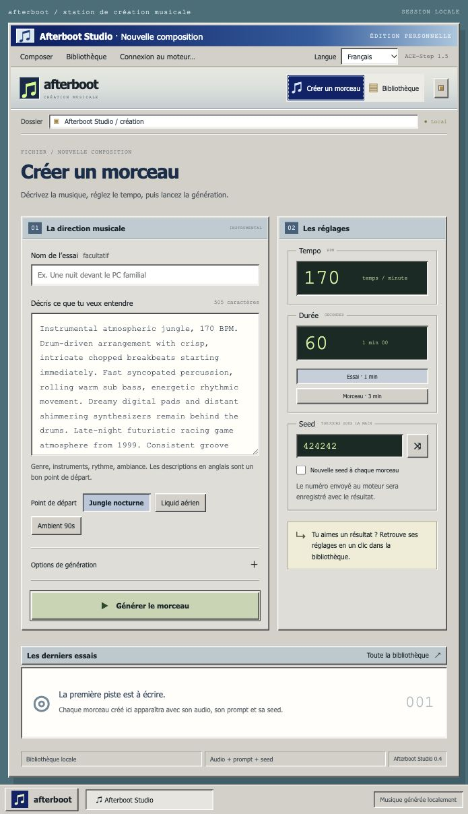
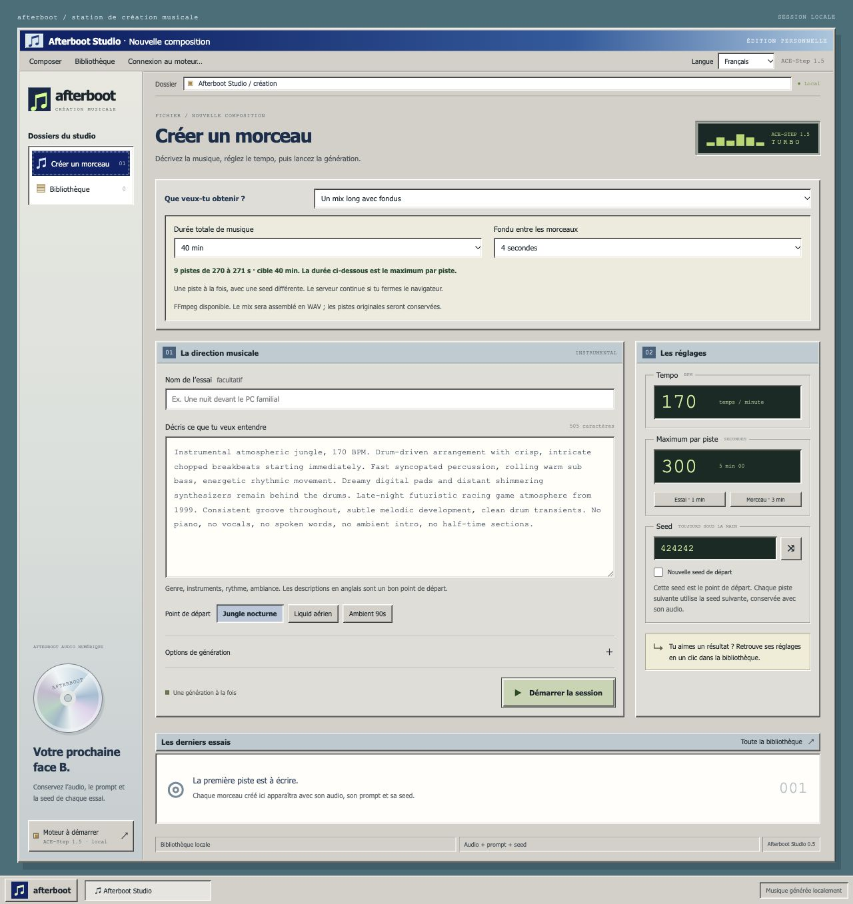
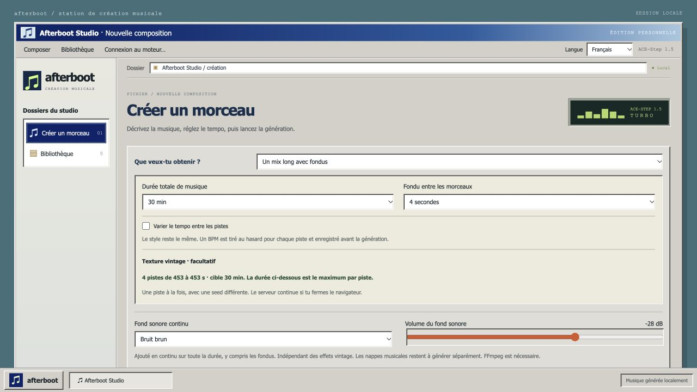
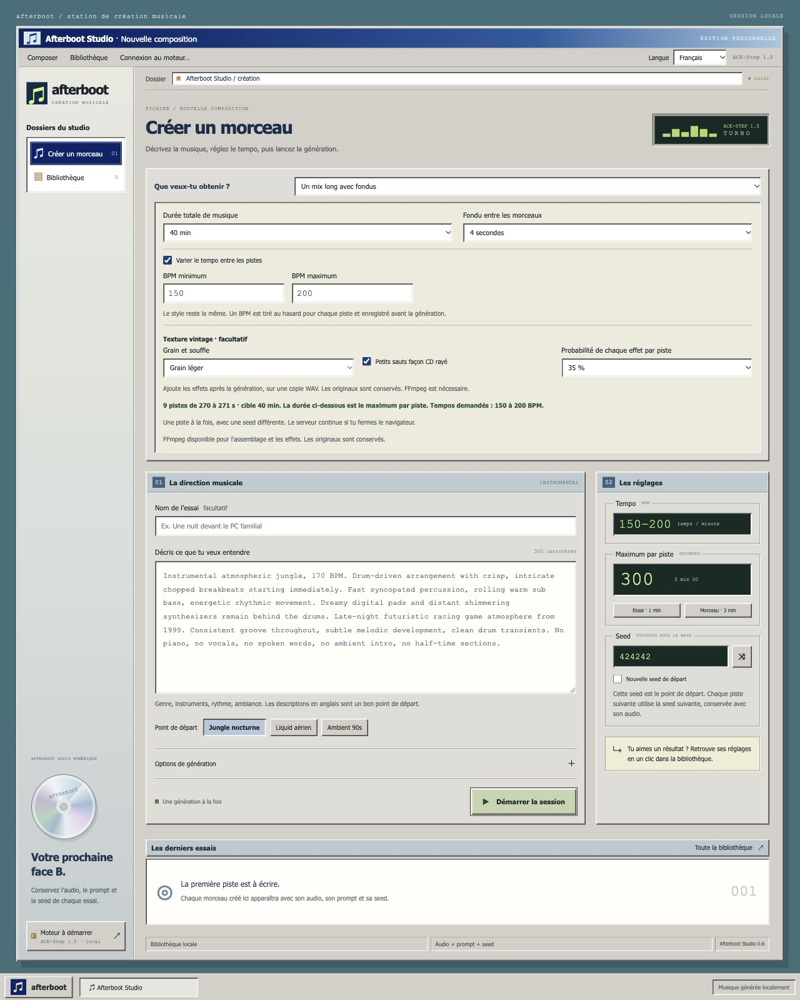

# Afterboot Studio

[English](README.md) · [Français](README.fr.md)

Un studio musical rétro pour l'[API officielle ACE-Step 1.5](https://github.com/ace-step/ACE-Step-1.5). Crée des instrumentaux, garde les seeds sous les yeux et retrouve tes morceaux dans une bibliothèque locale.

Interface communautaire indépendante. ACE-Step fonctionne séparément et assure toute la génération musicale. Aucun modèle n'est inclus.

## État du projet

La version 0.7.0 est une préversion. La génération d'un morceau a été signalée comme fonctionnelle sur Apple Silicon. Les sessions longues sont testées avec une API simulée, et l'assemblage ainsi que la durée de sortie sont vérifiés avec FFmpeg. La génération d'une session longue avec une installation réelle d'ACE-Step reste à valider. Les performances dépendent du moteur, des modèles et du matériel.

## Fonctionnalités

- Interface en anglais et français, avec mémorisation du choix par navigateur.
- Création d'instrumentaux avec prompt, tempo, durée et seed toujours visibles.
- Préréglages jungle, liquid DnB et ambient.
- ACE-Step Turbo, 8 étapes, un morceau à la fois et planification 5Hz LM facultative.
- Suivi réel des tâches, repris après rechargement de la page.
- Écoute, recherche, favoris et reprise des paramètres d'un morceau.
- Téléchargement WAV, FLAC ou MP3 et métadonnées de génération en JSON.
- Accès depuis un autre ordinateur du réseau privé.
- Sessions de 30, 40 ou 60 minutes de musique, en pistes séparées ou en mix WAV avec fondus.
- BPM tiré au hasard dans une plage pour chaque piste, avec grain et sauts façon CD facultatifs sur une copie de l'audio.
- Fond sonore continu blanc, rose, brun ou sombre, avec un volume réglable, y compris pendant les transitions du mix.

Changer la langue conserve les prompts, titres et réglages. Les prompts des préréglages restent en anglais. Les messages bruts du moteur conservent leur langue d'origine.

La seed seule ne garantit pas une reproduction identique entre versions de modèles, matériels ou nouvelles planifications LM.

## Prérequis

- Node.js 20 ou plus récent.
- Une API REST ACE-Step 1.5 installée et fonctionnelle avec le modèle Turbo.
- Un navigateur récent.

Aucune dépendance npm à installer pour cette interface. ACE-Step conserve ses propres dépendances et téléchargements de modèles. Commence par son [guide d'installation](https://github.com/ace-step/ACE-Step-1.5#readme).

## Démarrage local

Lance l'API depuis ton installation ACE-Step. Sur macOS avec Apple Silicon, le lanceur officiel est :

~~~bash
bash start_api_server_macos.sh
~~~

Attends la fin du chargement. L'adresse API par défaut est http://127.0.0.1:8001. Arrête d'abord ton processus Gradio si tu utilises la même installation et souhaites éviter de charger les modèles deux fois.

Dans un second terminal :

~~~bash
git clone https://github.com/Akhu/afterboot-studio.git
cd afterboot-studio
npm start
~~~

Ouvre [Afterboot Studio](http://127.0.0.1:3210).

Sur macOS, tu peux aussi double-cliquer sur `Lancer le studio.command`. Ce fichier démarre uniquement l'interface. Lance ACE-Step séparément.

Pour commencer, essaie 60 secondes à 170 BPM. L'interface accepte 10 à 600 secondes, mais ton moteur et ton matériel peuvent imposer des limites inférieures.

## Accès depuis le réseau local

Si l'interface et ACE-Step tournent sur la même machine, laisse Python sur son adresse locale par défaut. Lance l'interface avec :

~~~bash
npm run start:lan
~~~

Le terminal affiche les adresses réseau. Depuis un autre appareil connecté au même réseau privé, ouvre `http://<ip-machine-studio>:3210`. Utilise l'adresse IP affichée plutôt qu'un nom de machine. Autorise les connexions entrantes de Node si le pare-feu le demande.

Tous les appareils connectés partagent la bibliothèque du serveur et peuvent générer de la musique. Le mode réseau n'a pas de connexion par compte et s'utilise sur un réseau privé de confiance. N'expose pas ces ports sur Internet. Par défaut, `npm start` reste accessible uniquement depuis l'ordinateur hôte.

### Moteur ACE-Step sur une autre machine

Dans cette configuration, Python doit aussi accepter les connexions réseau. Sur le Mac Apple Silicon qui héberge ton installation ACE-Step avec uv, arrête le serveur actuel avec Ctrl+C, puis lance depuis le dossier ACE-Step :

~~~bash
ACESTEP_LM_BACKEND=mlx uv run acestep-api --host 0.0.0.0 --port 8001
~~~

Pour le paquet officiel avec Python embarqué, remplace `HOST="127.0.0.1"` par `HOST="0.0.0.0"` dans `start_api_server_macos.sh`, puis relance ce script. Ce réglage est interne au script : préfixer son lancement avec une variable HOST ne le remplace pas. Voir le [lanceur macOS officiel](https://github.com/ace-step/ACE-Step-1.5/blob/main/start_api_server_macos.sh).

Sur la machine qui héberge l'interface, indique l'IP du moteur :

~~~bash
ACESTEP_API_URL=http://<ip-machine-moteur>:8001 npm run start:lan
~~~

Ces affectations de variables utilisent la syntaxe macOS/Linux. Dans PowerShell, définis `$env:ACESTEP_API_URL = "http://<ip-machine-moteur>:8001"` avant de lancer npm.

## Générer 30–40 minutes de musique

Dans l'écran de création, choisis **Plusieurs morceaux** ou **Un mix long avec fondus**, puis une durée totale de 30 ou 40 minutes. Cette cible correspond à la durée de l'audio, pas au temps pendant lequel le Mac travaille. Utilise le prompt, le tempo et la planification musicale pour choisir la direction musicale.

Le champ de durée devient le maximum par piste. Commence avec 180 secondes pour les morceaux séparés ou 300 secondes pour un mix. Le plan équilibre les durées et affiche le nombre de pistes avant le lancement. Chaque piste reçoit une seed différente, dérivée de la seed de départ sauvegardée. Par exemple, 30 minutes de morceaux séparés avec une durée de 180 secondes donnent dix pistes.

ACE-Step accepte jusqu'à [600 secondes par génération](https://github.com/ace-step/ACE-Step-1.5#-features). Un mix de 30–40 minutes assemble donc plusieurs pistes indépendantes. Les fondus adoucissent les transitions ; ils ne garantissent ni un calage sur les temps ni une composition continue. Le plan ajoute assez d'audio source pour compenser les recouvrements des fondus.

**FFmpeg est nécessaire pour le mix assemblé, le fond sonore et les effets vintage**, sur l'ordinateur qui héberge le serveur Node du studio. Les pistes séparées sans effets, même avec des BPM aléatoires, fonctionnent sans lui. Sur macOS :

~~~bash
brew install ffmpeg
~~~

Redémarre le studio après l'installation. L'interface indique si FFmpeg est disponible. Sur les autres systèmes, installe FFmpeg dans le PATH, ou définis FFMPEG_PATH avec le chemin complet de son exécutable. Les mixes finaux sont des WAV PCM stéréo à 44,1 kHz. Les pistes originales conservent le format choisi et restent téléchargeables séparément. Un WAV de 40 minutes pèse environ 424 Mo, en plus des pistes originales.

La file fonctionne sur le serveur, une piste à la fois, même si le navigateur est fermé. Pause et arrêt prennent effet après la sauvegarde de la piste en cours. Une session en pause réserve la file jusqu'à sa reprise ou son arrêt. Après un redémarrage du serveur, les sessions inachevées restent en pause et doivent être reprises explicitement. Garde le studio et le moteur ouverts, et empêche la mise en veille de la machine pendant la session.

Les pistes, plans de session, seeds et états sont sauvegardés dans .data. Une erreur du moteur met la session en pause. Un envoi dont la réponse est incertaine n'est jamais réessayé automatiquement : le moteur peut déjà l'avoir accepté. Vérifie ACE-Step avant d'arrêter cette session et d'en créer une autre. La reprise ne régénère pas les pistes sauvegardées. Si l'assemblage échoue ou si une sortie du moteur est trop courte pour atteindre la cible, tous les originaux sont conservés.

## Ajouter un fond sonore continu

Dans l'écran de création, choisis **Fond sonore continu** : **Bruit blanc**, **Bruit rose**, **Bruit brun** ou **Bruit sombre · brun filtré**. Le bruit sombre est un bruit brun filtré entre 20 et 180 Hz. Le curseur règle le gain du générateur de bruit de -60 à -12 dB, avec -32 dB par défaut. Les couleurs de bruit peuvent sembler plus ou moins fortes au même réglage. Choisis **Désactivé** pour retirer le fond. Il est désactivé par défaut.

Le fond est intégré au fichier audio exporté. Pour un mix long, un seul flux de bruit est ajouté après l'assemblage : il traverse tous les fondus, sans redémarrage ni baisse de volume entre les pistes. Pour un morceau seul ou une session de pistes séparées, chaque copie WAV contient son propre bruit continu. Les fichiers du moteur restent téléchargeables avec **Original**. Le type, le volume et la seed du bruit sont sauvegardés avec les paramètres de la piste ou de la session.

Le fond sonore est indépendant de la probabilité des effets vintage et ajouté après les sauts CD, qui ne l'interrompent donc pas. Un limiteur protège la sortie contre l'écrêtage. Ce réglage ajoute uniquement du bruit ; les nappes musicales sans beats restent à générer séparément. Les fichiers déjà présents dans la bibliothèque ne sont pas modifiés. FFmpeg est nécessaire.

## Varier les tempos et ajouter une texture vintage

Dans les deux modes de session, active **Varier le tempo entre les pistes**, puis saisis un minimum et un maximum, par exemple 150 et 200 BPM. Chaque piste reçoit un BPM entier tiré uniformément dans cette plage, bornes incluses. Tous les choix sont sauvegardés avant le lancement et restent identiques lors d'un nouvel essai ou d'une reprise. Le studio adapte les mentions numériques de BPM dans le prompt, tout en conservant le prompt original de la session. Ces tempos sont demandés au modèle ; son interprétation dans l'audio peut varier. Les transitions utilisent des fondus, sans calage automatique sur les temps ni modification de vitesse.

Dans **Texture vintage**, choisis **Grain léger** ou **Cassette usée**, et active éventuellement **Petits sauts façon CD rayé**. Le grain ajoute un souffle rose discret, une bande de fréquences plus étroite et une saturation douce. Les sauts CD remplacent une courte portion par des fragments répétés de 68 à 136 ms, à raison d'environ un événement par tranche de 100 secondes sur les pistes sélectionnées. C'est une simulation ajoutée après génération, qui conserve la durée du morceau.

La probabilité s'applique indépendamment à chaque effet activé, pour chaque piste. À 35 %, certaines pistes reçoivent un effet et d'autres restent propres ; ce n'est pas un quota exact. Les deux effets sont désactivés par défaut. Les réglages, seeds du souffle et positions des sauts sont conservés dans les métadonnées. Le plan des pistes affiche les tempos et effets choisis avant la génération.

Les copies traitées sont des WAV stéréo, même si l'original est en MP3 ou FLAC. L'écoute et l'assemblage utilisent la copie traitée. Le bouton **Original** télécharge la sortie intacte du moteur. Si le traitement échoue, la session se met en pause et garde l'original. Reprendre réessaie les réglages sauvegardés sans envoyer une nouvelle génération. Les anciennes sessions et la génération d'un seul morceau conservent leur fonctionnement.

## Configuration

| Variable | Valeur par défaut | Rôle |
| --- | --- | --- |
| `ACESTEP_API_URL` | `http://127.0.0.1:8001` | Adresse de l'API ACE-Step |
| `ACESTEP_API_KEY` | Vide | Clé facultative du moteur, transmise uniquement par le serveur Node |
| `PORT` | `3210` | Port du studio |
| `HOST` | `127.0.0.1` | `0.0.0.0` pour le réseau, ou utilise `npm run start:lan` |
| `FFMPEG_PATH` | `ffmpeg` dans le PATH | Chemin facultatif de l'exécutable pour assembler les mixes longs |

Définis les variables dans le terminal de lancement. Le studio ne charge pas automatiquement de fichier .env. Pour activer une clé API côté moteur, consulte la [documentation officielle d'authentification](https://github.com/ace-step/ACE-Step-1.5/blob/main/docs/en/API.md#1-authentication).

## Stockage et périmètre

Le dossier `.data/`, à côté du serveur, contient l'audio et les métadonnées. Sauvegarde ce dossier pour conserver la bibliothèque. Il est exclu de Git, comme les fichiers d'environnement. Les brouillons et préférences de langue restent dans le stockage local de chaque navigateur.

Le studio copie les morceaux terminés depuis ACE-Step vers sa bibliothèque. Les anciens résultats Gradio ne sont pas importés automatiquement. Un suivi mis en pause n'annule pas la génération sur le moteur. Utilise « Vérifier l'état » pour le reprendre. Avant leur copie, les résultats restent soumis à la politique de cache du moteur.

Cette préversion couvre la création d'instrumentaux à partir de texte et l'assemblage de sessions. Remix, repaint et entraînement LoRA ne sont pas inclus. Le backend LM est MLX sur macOS et PyTorch ailleurs.

## Développement

~~~bash
npm test
~~~

Les tests couvrent la validation, l'envoi et le suivi des tâches, la copie et la lecture partielle de l'audio, les seeds renvoyées, la persistance, les erreurs du moteur, les contrôles réseau, les files de session, la pause et la reprise après redémarrage, ainsi que le calcul des durées. Avec FFmpeg installé, ils assemblent aussi des sons de test et vérifient les fondus et la durée finale. Ils ne téléchargent aucun modèle et ne génèrent pas de musique.

L'application utilise HTML, CSS et JavaScript côté navigateur avec un serveur Node.js. Les requêtes suivent ce chemin :

~~~text
Navigateur → serveur Node Afterboot → API REST officielle ACE-Step
~~~

Le serveur utilise `/release_task`, `/query_result`, `/health` et `/v1/audio`.

## Crédits et licence

La génération musicale repose sur [ACE-Step 1.5](https://github.com/ace-step/ACE-Step-1.5). Merci aux auteurs et contributeurs d'ACE-Step pour le moteur et sa [documentation API](https://github.com/ace-step/ACE-Step-1.5/blob/main/docs/en/API.md).

Afterboot Studio est un client indépendant, maintenu séparément d'ACE-Step, sans affiliation officielle. Cette interface est disponible sous [licence MIT](LICENSE). ACE-Step et ses modèles conservent leurs licences respectives. Consulte la [licence amont](https://github.com/ace-step/ACE-Step-1.5/blob/main/LICENSE) et les fiches des modèles avant utilisation.
