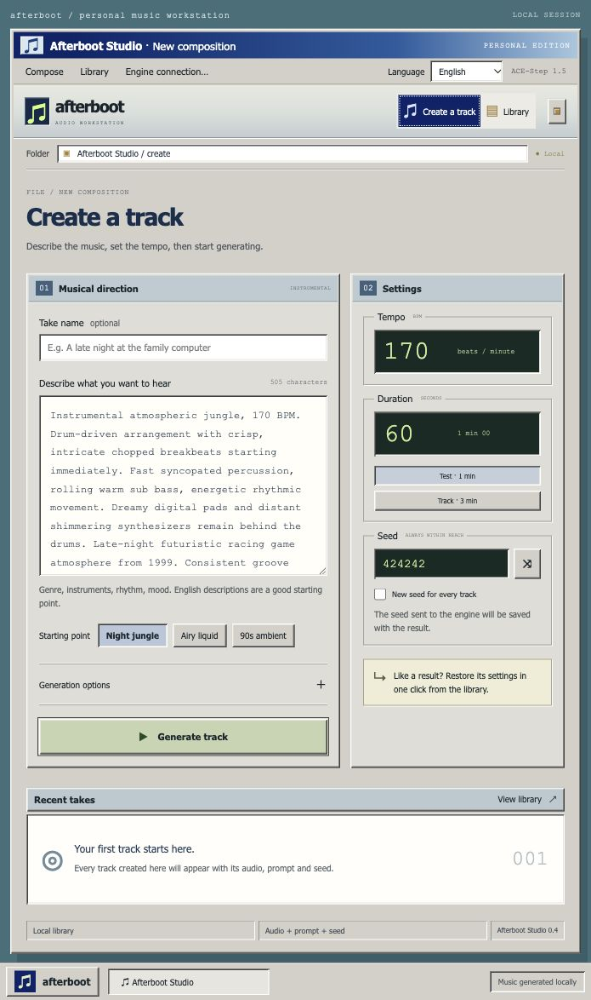
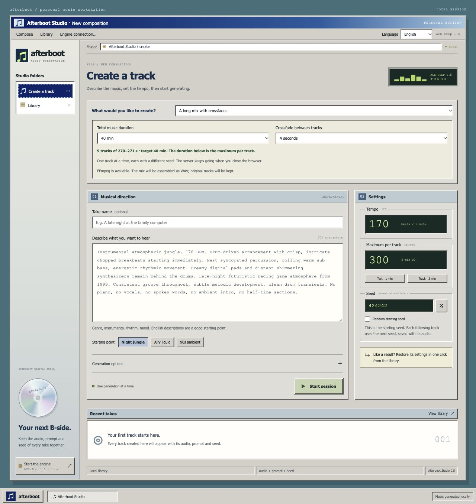

# Afterboot Studio

[English](README.md) · [Français](README.fr.md)

A retro music workstation for the [official ACE-Step 1.5](https://github.com/ace-step/ACE-Step-1.5) API. Create instrumentals, keep your seeds in view, and collect your tracks in a local library.

Independent community UI. ACE-Step runs separately and provides all music generation. No model weights are bundled.

## Preview status

Version 0.5.0 is an early preview. Single-track generation has been reported working on Apple Silicon. Long sessions are tested against a simulated API, with real FFmpeg tests for assembly and output duration. Long-session generation on a real ACE-Step installation still needs validation. Hardware performance depends on the engine and its models.

## What you can do

- Switch between English and French. Your language choice is saved per browser.
- Create instrumentals with a prompt, BPM, duration and a visible seed.
- Start with jungle, liquid DnB and ambient presets.
- Use ACE-Step Turbo with 8 steps, one track at a time, and optional 5Hz LM planning.
- Follow actual job status and resume tracking after reloading the page.
- Listen, search, mark favorites and restore a track's generation settings.
- Download WAV, FLAC or MP3 audio and JSON generation metadata.
- Open the studio from another computer on your private network.
- Queue 30, 40 or 60 minutes of music, as separate tracks or one WAV mix with crossfades.

Switching UI languages preserves prompts, titles and settings. Preset prompts stay in English. Raw engine messages retain their original language.

A seed alone does not guarantee identical audio across different model versions, hardware or LM planning runs.

## Requirements

- Node.js 20 or newer.
- An installed and working ACE-Step 1.5 REST API with the Turbo model.
- A modern browser.

This project has no npm dependencies. ACE-Step has its own installation requirements and model downloads. Follow its [installation guide](https://github.com/ace-step/ACE-Step-1.5#readme) first.

## Start locally

Start the API from your ACE-Step installation. On Apple Silicon macOS, the official launcher is:

~~~bash
bash start_api_server_macos.sh
~~~

Wait for the engine to finish loading. The default API address is http://127.0.0.1:8001. Stop your existing Gradio process first if you use the same engine installation and want to avoid loading the models twice.

In a second terminal:

~~~bash
git clone https://github.com/Akhu/afterboot-studio.git
cd afterboot-studio
npm start
~~~

Open [Afterboot Studio](http://127.0.0.1:3210).

On macOS, you can also double-click `Lancer le studio.command`. It starts the UI only. Start ACE-Step separately.

Try 60 seconds at 170 BPM first. The UI supports 10–600 seconds, but your engine and hardware may impose lower limits.

## Use another computer on your network

If the UI and ACE-Step run on the same machine, leave Python on its default loopback address. Start the UI with:

~~~bash
npm run start:lan
~~~

The terminal prints the network URLs. On another device connected to the same private network, open `http://<studio-machine-ip>:3210`. Use the printed IP address rather than a hostname. Allow Node's incoming connections if your firewall asks.

All connected users share the server's library and can generate music. LAN mode has no login and is intended for a trusted private network. Keep these ports off the public internet. The default `npm start` remains accessible only on the host computer.

### Run ACE-Step on a separate machine

Only in this setup does Python also need a network listener. On the Apple Silicon machine hosting an existing uv-based ACE-Step installation, stop its current server with Ctrl+C, then run this inside the ACE-Step folder:

~~~bash
ACESTEP_LM_BACKEND=mlx uv run acestep-api --host 0.0.0.0 --port 8001
~~~

For the official embedded-Python package, change `HOST="127.0.0.1"` to `HOST="0.0.0.0"` inside `start_api_server_macos.sh`, then relaunch that script. Its HOST setting is internal, so prefixing the script with a HOST environment variable does not override it. See the [official macOS launcher](https://github.com/ace-step/ACE-Step-1.5/blob/main/start_api_server_macos.sh).

On the machine hosting this UI, point it to the engine's IP:

~~~bash
ACESTEP_API_URL=http://<engine-machine-ip>:8001 npm run start:lan
~~~

These environment assignments use macOS/Linux shell syntax. In PowerShell, set `$env:ACESTEP_API_URL = "http://<engine-machine-ip>:8001"` before running npm.

## Generate 30–40 minutes of music

In the creation screen, choose **Multiple tracks** or **A long mix with crossfades**, then choose a total duration of 30 or 40 minutes. The target is audio duration, not how long the computer will run. Use the existing prompt, BPM and music-planning controls to set the musical direction.

The duration field is the maximum length of an individual track. Start with 180 seconds for separate tracks or 300 seconds for a mix. The planner balances the individual lengths and shows the number of tracks before you start. Every track receives a different seed derived from the saved starting seed. For example, 30 minutes of separate tracks at 180 seconds produces ten tracks.

ACE-Step supports up to [600 seconds per generation](https://github.com/ace-step/ACE-Step-1.5#-features). A 30–40 minute mix is assembled from independently generated tracks. Crossfades soften the transitions; they do not provide beat matching or guarantee continuous composition. The planner adds enough source audio to compensate for overlapping fades.

**FFmpeg is required only for the assembled mix**, on the computer running the Node studio. It is not needed for separate-track sessions. On macOS:

~~~bash
brew install ffmpeg
~~~

Restart the studio after installing FFmpeg. The UI reports whether it is available. On other systems, install FFmpeg and make it available on PATH, or set FFMPEG_PATH to the executable's full path. Final mixes are stereo 44.1 kHz PCM WAV files. The original tracks keep their selected format and remain downloadable individually. A 40-minute WAV is approximately 424 MB, in addition to the original tracks.

The queue runs on the server, one track at a time, even with the browser closed. Pause and stop take effect after the current track is saved. A paused session reserves the queue until resumed or stopped. After a server restart, unfinished sessions are paused; resume them explicitly. Keep the studio and engine running and prevent the host computer from sleeping during a session.

Tracks, session plans, seeds and progress are saved in .data. Engine failures pause the session. A submission with an uncertain response is not retried automatically because the engine may already have accepted it. Check ACE-Step before stopping that session and creating another. Already saved tracks are never regenerated on resume. If assembly fails or an engine output is too short to meet the target, all original tracks are retained.

## Configuration

| Variable | Default | Purpose |
| --- | --- | --- |
| `ACESTEP_API_URL` | `http://127.0.0.1:8001` | ACE-Step API address |
| `ACESTEP_API_KEY` | Empty | Optional engine key, sent only by the Node server |
| `PORT` | `3210` | Studio port |
| `HOST` | `127.0.0.1` | Set to `0.0.0.0` for LAN access, or use `npm run start:lan` |
| `FFMPEG_PATH` | `ffmpeg` on PATH | Optional executable path for assembling long mixes |

Environment variables must be set in the launching terminal. The studio does not automatically load .env files. Configure an optional engine API key following the [official authentication documentation](https://github.com/ace-step/ACE-Step-1.5/blob/main/docs/en/API.md#1-authentication).

## Storage and scope

Audio and generation metadata live in `.data/` beside the server. Back up that folder to keep the library. It is excluded from Git along with environment files. Drafts and language preferences live in each browser's local storage.

The studio copies completed audio from ACE-Step into its own library. Existing Gradio outputs are not imported automatically. A paused job tracker does not cancel generation on the engine; use “Check status” to resume it. Pending outputs remain subject to the engine's cache policy until copied.

This preview supports instrumental text-to-music and session assembly. Remix, repaint and LoRA training are outside its current scope. The LM backend is MLX on macOS and PyTorch elsewhere.

## Development

~~~bash
npm test
~~~

Tests cover input validation, submission and polling, audio archiving and range playback, returned seeds, persistence, engine failures, LAN host/origin checks, session queues, pause/restart recovery and duration planning. When FFmpeg is installed, tests also assemble synthetic audio and verify crossfades and final duration. They do not download models or generate music.

The app uses HTML, CSS and browser JavaScript with a Node.js server. Requests follow this path:

~~~text
Browser → Afterboot Node server → official ACE-Step REST API
~~~

The server uses `/release_task`, `/query_result`, `/health` and `/v1/audio`.

## Credits and license

Music generation is powered by [ACE-Step 1.5](https://github.com/ace-step/ACE-Step-1.5). Thanks to the ACE-Step authors and contributors for the engine and its [API documentation](https://github.com/ace-step/ACE-Step-1.5/blob/main/docs/en/API.md).

Afterboot Studio is an independent client, maintained separately from ACE-Step, with no official affiliation. This UI is available under the [MIT license](LICENSE). ACE-Step and its models retain their respective licenses; consult the [upstream license](https://github.com/ace-step/ACE-Step-1.5/blob/main/LICENSE) and model cards before use.
